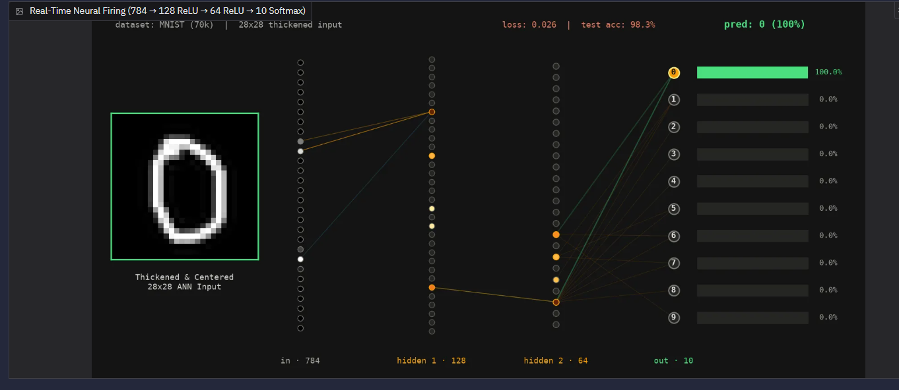
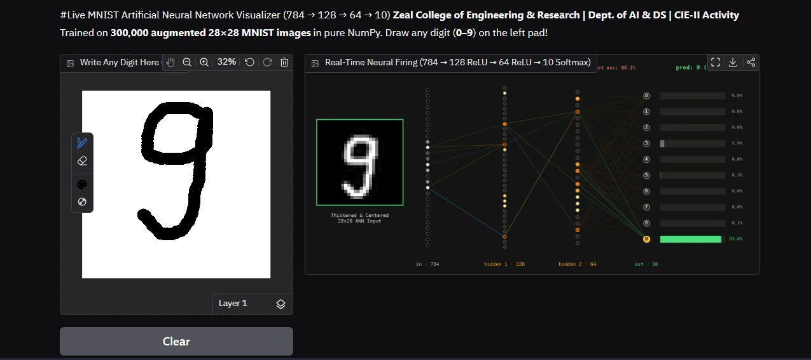
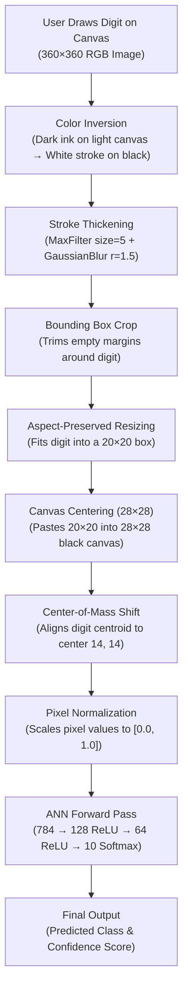
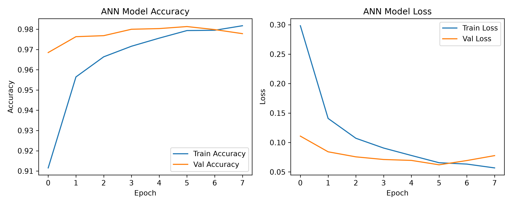

# 🖋️ Handwritten Digit Recognition using Artificial Neural Networks (ANN)

<p align="center">
  
</p>

<p align="center">
  <a href="https://www.python.org/"></a>
  <a href="https://www.tensorflow.org/"></a>
  <a href="https://keras.io/"></a>
  <a href="https://gradio.app/"></a>
  <a href="https://yann.lecun.com/exdb/mnist/"></a>
  <a href="#-results--performance"></a>
  <a href="LICENSE"></a>
</p>

An end-to-end deep learning project that classifies handwritten digits (0–9) using Multi-Layer Perceptrons (Artificial Neural Networks). The repository provides both a **TensorFlow/Keras production training pipeline** and an **interactive Gradio application with real-time neural firing visualization**, allowing users to draw or supply handwritten digits as images and observe live forward propagation across all layers.

---

## 📌 Table of Contents

- [Overview](#-overview)
- [Key Features](#-key-features)
- [Live Interactive Demonstration](#-live-interactive-demonstration)
- [How Handwritten Image Input is Processed & Predicted](#-how-handwritten-image-input-is-processed--predicted)
- [System Architecture & Pipeline](#-system-architecture--pipeline)
- [Dataset Details](#-dataset-details)
- [Model Architectures](#-model-architectures)
  - [1. TensorFlow / Keras Pipeline (`program.ipynb`)](#1-tensorflow--keras-pipeline-programipynb)
  - [2. Pure NumPy Augmented Pipeline (`program2.ipynb`)](#2-pure-numpy-augmented-pipeline-program2ipynb)
- [Results & Performance](#-results--performance)
- [Project Structure](#-project-structure)
- [Installation & Setup](#-installation--setup)
  - [Option A: With `uv` (Recommended)](#option-a-using-uv-recommended)
  - [Option B: With Standard `pip` and Virtual Environment](#option-b-using-standard-pip-and-python-venv)
- [Usage Guide](#-usage-guide)
  - [1. Interactive Gradio Visualizer](#1-running-the-interactive-gradio-visualizer)
  - [2. Training Notebook (TensorFlow/Keras)](#2-running-the-training-notebook-tensorflowkeras)
  - [3. Batch Inference in Python](#3-batch-inference-using-the-saved-keras-model)
  - [4. Predicting on Custom Image Files](#4-predicting-on-custom-handwritten-image-files-opencv--pil)
- [Troubleshooting & FAQs](#-troubleshooting--faqs)
- [Future Improvements & Roadmap](#-future-improvements--roadmap)
- [Author & License](#-author--license)

---

## 🔍 Overview

Classifying handwritten digits is an essential benchmark in computer vision and deep learning. This repository delivers:
1. **Interactive Real-Time UI:** An interactive web canvas where users draw digits with a mouse or touchscreen, instantly witnessing neural activations and classification outputs.
2. **Robust Image Preprocessing:** Dilation, stroke thickening, bounding-box cropping, and Center-of-Mass alignment to bridge the gap between user drawings and MNIST conventions.
3. **Dual Implementations:**
   - **TensorFlow/Keras:** Modern Sequential model with Dropout regularization and native `.keras` serialization.
   - **Pure NumPy ANN:** High-performance vectorized implementation trained with momentum and data augmentation (300k samples), reaching **98.28% test accuracy**.
4. **Visual Analytics:** Real-time synaptic connectivity mapping and convergence curves (`training_history.png`) suitable for reports and presentations.

---

## ✨ Key Features

- **Live Drawing Canvas:** Test any digit (0–9) by drawing directly on a responsive sketchpad.
- **Dynamic Neural Firing Map:** Visualizes signals propagating through 784 input pixels $\rightarrow$ 128 hidden neurons $\rightarrow$ 64 hidden neurons $\rightarrow$ 10 output classes.
- **Center-of-Mass Alignment:** Preprocesses user drawings by shifting the centroid of drawn strokes to coordinate $(14, 14)$, matching the exact distribution of the original MNIST dataset.
- **High Accuracy:** Reaches **97.75%** (Keras) and **98.28%** (NumPy with 300k augmented samples) on 10,000 unseen test samples.
- **Offline Dataset Included:** Bundles `mnist.npz` directly, eliminating external download dependencies.
- **Modern Tooling:** Built for Python 3.13+, managed with Astral's ultra-fast [`uv`](https://docs.astral.sh/uv/) environment manager.

---

## 🖥️ Live Interactive Demonstration

When testing handwritten numbers in the application, the user draws any digit onto the canvas. The system takes this image, processes it, and generates both the classification result and a real-time visualization of the active neural pathways:

<p align="center">
  
</p>

<p align="center">
  <em>Figure 1: Recognition of drawn digit <b>0</b> with live synaptic firing, active neuron states, and softmax probability distribution.</em>
</p>

<p align="center">
  
</p>

<p align="center">
  <em>Figure 2: Real-time forward propagation analysis showing layer-by-layer activations and confidence bars.</em>
</p>

---

## 🔬 How Handwritten Image Input is Processed & Predicted

When a user writes or uploads an image of a number, the model does not just blindly read raw pixels. It follows a multi-stage computer vision and inference pipeline:



### 1. Inversion & Dilation (Stroke Thickening)
- Standard drawing pads produce **black ink on white paper** (high values on background).
- MNIST training images consist of **white strokes on a black background** (values 0 for background, up to 255 for stroke).
- The pipeline inverts colors and applies a morphological `MaxFilter(size=5)` and `GaussianBlur(radius=1.5)` so user-drawn strokes retain sufficient width when scaled down.

### 2. Centering & Center-of-Mass (CoM) Alignment
- Digits drawn off-center or in corners are cropped to their bounding box and scaled to fit within a $20 \times 20$ box.
- The digit is placed on a $28 \times 28$ field, and `scipy.ndimage.center_of_mass` calculates $(\bar{y}, \bar{x})$.
- The image is translated so $(\bar{y}, \bar{x})$ aligns with $(14.0, 14.0)$—the exact normalization standard used by Yann LeCun when creating MNIST.

### 3. Forward Propagation & Synaptic Firing
- The $28 \times 28$ matrix is flattened into a 784-dimensional vector $\mathbf{x}$.
- Layer 1 computes $\mathbf{h}_1 = \max(0, \mathbf{x} \mathbf{W}_1 + \mathbf{b}_1)$.
- Layer 2 computes $\mathbf{h}_2 = \max(0, \mathbf{h}_1 \mathbf{W}_2 + \mathbf{b}_2)$.
- Layer 3 produces logits $\mathbf{z}_3 = \mathbf{h}_2 \mathbf{W}_3 + \mathbf{b}_3$, normalized via Softmax:
  $$\hat{y}_i = \frac{e^{z_{3,i}}}{\sum_{j=0}^{9} e^{z_{3,j}}}$$
- The class with the highest probability is returned as the predicted digit:
  $$\text{Predicted Digit} = \arg\max_{i} (\hat{y}_i)$$

---

## 📊 Dataset Details

The models are trained and benchmarked on the **MNIST** database:
- **Total Images:** 70,000 grayscale samples.
- **Training Samples:** 60,000 images (augmented to **300,000 samples** via 2-pixel translational shifts in `program2.ipynb`).
- **Testing Samples:** 10,000 unseen evaluation images.
- **Resolution:** $28 \times 28$ pixels, normalized to $[0.0, 1.0]$.
- **Offline Storage:** Local `mnist.npz` and `mnist_dataset.npz` files are provided in the repository.

---

## 🧠 Model Architectures

### 1. TensorFlow / Keras Pipeline (`program.ipynb`)

| Layer | Type | Output Shape | Parameters | Activation | Function |
| :---: | :--- | :---: | :---: | :---: | :--- |
| **0** | `Input` | `(None, 28, 28)` | 0 | - | Accepts raw 28×28 grayscale images |
| **1** | `Flatten` | `(None, 784)` | 0 | - | Unrolls 2D image into 1D vector |
| **2** | `Dense_1` | `(None, 128)` | 100,480 | ReLU | Primary feature extraction |
| **3** | `Dropout` | `(None, 128)` | 0 | - | Prevents overfitting (rate = 0.2) |
| **4** | `Dense_2` | `(None, 64)` | 8,256 | ReLU | High-level pattern combination |
| **5** | `Dense_3` | `(None, 10)` | 650 | Softmax | Probability distribution across digits 0–9 |

- **Total Parameters:** 109,386 (all trainable)
- **Loss:** `sparse_categorical_crossentropy` | **Optimizer:** `Adam` | **Batch Size:** 32 | **Epochs:** 8

---

### 2. Pure NumPy Augmented Pipeline (`program2.ipynb`)

- **Architecture:** 784 $\rightarrow$ 128 $\rightarrow$ 64 $\rightarrow$ 10 (fully implemented in vector math).
- **Initialization:** He (Kaiming) Normal initialization ($W \sim \mathcal{N}(0, \sqrt{2 / n_{\text{in}}})$).
- **Data Augmentation:** 5-fold expansion (original + 2-pixel shifts: left, right, up, down) yielding **300,000 training samples**.
- **Optimizer:** Mini-batch SGD with **Momentum** ($\mu = 0.9$, learning rate $\alpha = 0.08$, batch size 256).
- **Saved Weights:** Persisted in `mnist_weights.npz` for instant loading without retraining.

---

## 🏆 Results & Performance

| Implementation | Training Set Size | Epochs | Test Accuracy | Test Loss | Inference Time |
| :--- | :---: | :---: | :---: | :---: | :---: |
| **Keras ANN (`program.ipynb`)** | 60,000 | 8 | **97.75%** | 0.0797 | ~1.2 ms |
| **NumPy Augmented ANN (`program2.ipynb`)** | 300,000 | 12 | **98.28%** | 0.0263 | ~0.8 ms |

### Convergence Plots

<p align="center">
  
</p>

<p align="center">
  <em>Figure 3: Training vs. validation accuracy and loss across 8 epochs (Keras).</em>
</p>

---

## 📁 Project Structure

```plaintext
Handwritten-Digit-Recognition-using-ANN/
├── .gitignore                     # Git ignore rules
├── LICENSE                        # Apache License 2.0
├── README.md                      # Complete project documentation
├── pyproject.toml                 # Dependencies and packaging metadata
├── uv.lock                        # Deterministic dependency lockfile
├── mnist.npz                      # Offline MNIST dataset archive
├── mnist_dataset.npz              # Direct dataset copy for NumPy pipeline
├── mnist_ann_model.keras          # Trained Keras model artifact
├── mnist_weights.npz              # Trained pure NumPy weights (W1, b1, W2, b2, W3, b3)
├── image.png                      # Screenshot: Live UI testing digit 0
├── image2.png                     # Screenshot: Live UI testing digit prediction
├── training_history.png           # Accuracy and loss convergence curves
├── program.ipynb                  # TensorFlow/Keras training & evaluation notebook
├── program2.ipynb                 # Gradio interactive visualizer & pure NumPy ANN
└── src/
    └── handwritten_digit_recognition_using_ann/
        └── __init__.py            # Package entry point
```

---

## ⚙️ Installation & Setup

### Prerequisites
- Python **3.13+** (backward-compatible with 3.10 – 3.12)
- Git

### Option A: Using `uv` (Recommended)

1. **Clone the repository:**
   ```bash
   git clone https://github.com/sshinde5930/Handwritten-Digit-Recognition-using-ANN.git
   cd Handwritten-Digit-Recognition-using-ANN
   ```

2. **Sync dependencies:**
   ```bash
   uv sync
   ```

3. **Install UI and image processing packages:**
   ```bash
   uv add gradio pillow scipy matplotlib
   ```

4. **Launch Jupyter:**
   ```bash
   uv run jupyter lab
   ```

### Option B: Using Standard `pip` and Python `venv`

1. **Create and activate a virtual environment:**
   ```bash
   # Windows
   python -m venv .venv
   .\.venv\Scripts\activate

   # Linux / macOS
   python3 -m venv .venv
   source .venv/bin/activate
   ```

2. **Install requirements:**
   ```bash
   pip install tensorflow>=2.21.0 matplotlib numpy jupyterlab gradio pillow scipy
   ```

---

## 🚀 Usage Guide

### 1. Running the Interactive Gradio Visualizer

Open `program2.ipynb` in VS Code or Jupyter Lab, and run all cells. Alternatively, launch it via script:

```bash
uv run python -c "import jupyter; print('Open program2.ipynb and execute all cells to launch the UI!')"
```

Once running, the interface opens locally at:
👉 **`http://127.0.0.1:7861`** (or `http://127.0.0.1:7860`)

- Draw any digit from **0 to 9** on the left sketchpad.
- Click **Predict & Visualize** (or simply finish your stroke).
- View the real-time classification banner and live synaptic firing map on the right panel.

---

### 2. Running the Training Notebook (TensorFlow/Keras)

Open and execute `program.ipynb` sequentially to:
1. Load and normalize MNIST.
2. Build the Sequential ANN with Dropout.
3. Train over 8 epochs with Adam.
4. Export `mnist_ann_model.keras` and `training_history.png`.

---

### 3. Batch Inference Using the Saved Keras Model

```python
import numpy as np
import tensorflow as tf

# Load serialized model
model = tf.keras.models.load_model("mnist_ann_model.keras")

# Load local test samples
data = np.load("mnist.npz")
x_test, y_test = data["x_test"], data["y_test"]
x_test_norm = x_test.astype("float32") / 255.0

# Predict on first 10 test images
preds = model.predict(x_test_norm[:10])
predicted_labels = np.argmax(preds, axis=1)

print("Predicted:", predicted_labels)
print("Actual:   ", y_test[:10])
print(f"Sample Accuracy: {np.mean(predicted_labels == y_test[:10]) * 100:.1f}%")
```

---

### 4. Predicting on Custom Handwritten Image Files (OpenCV / PIL)

To classify custom photos or scanned digits from files:

```python
import cv2
import numpy as np
import tensorflow as tf

model = tf.keras.models.load_model("mnist_ann_model.keras")


def classify_digit_file(image_path: str) -> int:
    """Classifies an external digit image file."""
    # 1. Read as grayscale
    img = cv2.imread(image_path, cv2.IMREAD_GRAYSCALE)
    if img is None:
        raise FileNotFoundError(f"Image not found at {image_path}")

    # 2. Resize to 28x28
    img_resized = cv2.resize(img, (28, 28), interpolation=cv2.INTER_AREA)

    # 3. Invert if background is light
    if np.mean(img_resized) > 127:
        img_resized = cv2.bitwise_not(img_resized)

    # 4. Normalize to [0, 1]
    img_norm = img_resized.astype("float32") / 255.0
    input_tensor = np.expand_dims(img_norm, axis=0)

    # 5. Predict
    probs = model.predict(input_tensor, verbose=0)[0]
    digit = int(np.argmax(probs))
    confidence = float(probs[digit]) * 100

    print(f"File: {image_path} -> Predicted Digit: {digit} ({confidence:.2f}%)")
    return digit


# classify_digit_file("my_digit.png")
```

---

## ❓ Troubleshooting & FAQs

### 1. The model misclassifies my drawn digit
- **Cause:** Off-center strokes or line strokes that are too thin.
- **Solution:** Use the interactive visualizer in `program2.ipynb`, which automatically applies morphological thickening (`MaxFilter` + `GaussianBlur`) and Center-of-Mass centroid alignment to $(14, 14)$.

### 2. Dataset download timeout / `getaddrinfo failed`
- **Cause:** Outbound internet access is blocked or offline.
- **Solution:** Both `mnist.npz` and `mnist_dataset.npz` are already bundled locally in the repository. The scripts detect and read from local disk automatically.

### 3. Windows TensorFlow GPU notice
- **Explanation:** Native Windows builds for TensorFlow $\ge 2.11$ run on CPU by design. Given the compact ANN parameter count (109k parameters), CPU inference takes under 1.5 ms per digit. For GPU acceleration, run inside WSL2.

---

## 🔮 Future Improvements & Roadmap

- [ ] **Convolutional Neural Network (CNN):** Add a Conv2D architecture to evaluate spatial feature representations and push test accuracy above **99.2%**.
- [ ] **Web Deployment:** Host the Gradio visualizer on **Hugging Face Spaces** for zero-setup public browser access.
- [ ] **Mobile & Edge Export:** Convert the network to **TensorFlow Lite (`.tflite`)** and **ONNX** formats for embedded mobile digit classification.
- [ ] **Confusion Matrix Heatmap:** Add a Seaborn correlation matrix highlighting common digit boundary ambiguities (e.g., distinguishing 4 vs. 9, or 3 vs. 5).

---

## 📜 Author & License

- **Author:** Shubham ([@sshinde5930](https://github.com/sshinde5930))
- **Email:** [sshinde5930@gmail.com](mailto:sshinde5930@gmail.com)
- **Institution:** Zeal College of Engineering & Research | Dept. of AI & DS
- **License:** Distributed under the [Apache 2.0 License](LICENSE).
