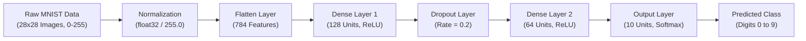

# 🖋️ Handwritten Digit Recognition using Artificial Neural Networks (ANN)

[](https://www.python.org/)
[](https://www.tensorflow.org/)
[](https://keras.io/)
[-4B8BBE.svg)](https://yann.lecun.com/exdb/mnist/)
[](#-results--performance)
[](#-results--performance)
[](LICENSE)

An end-to-end deep learning project that classifies handwritten digits (0–9) using a Multi-Layer Perceptron (Artificial Neural Network) implemented with **TensorFlow** and **Keras**. The model is trained and evaluated on the classic **MNIST** dataset, achieving **97.75% test accuracy** with low-latency CPU inference.

---

## 📌 Table of Contents

- [Overview](#-overview)
- [Key Features](#-key-features)
- [System Pipeline](#-system-pipeline)
- [Dataset Details](#-dataset-details)
- [Model Architecture](#-model-architecture)
- [Training & Convergence History](#-training--convergence-history)
- [Results & Performance](#-results--performance)
- [Project Structure](#-project-structure)
- [Installation & Setup](#-installation--setup)
  - [Option A: With `uv` (Recommended)](#option-a-using-uv-recommended)
  - [Option B: With Standard `pip` and Virtual Environment](#option-b-using-standard-pip-and-python-venv)
- [Usage Guide](#-usage-guide)
  - [1. Running the Interactive Notebook](#1-running-the-training-notebook)
  - [2. Loading the Model for Batch Predictions](#2-loading-the-saved-model-for-batch-predictions)
  - [3. Visualizing Sample Predictions with Matplotlib](#3-visualizing-predictions-with-sample-images)
  - [4. Classifying Custom Handwritten Images (OpenCV / PIL)](#4-predicting-on-custom-handwritten-images)
- [Troubleshooting & FAQs](#-troubleshooting--faqs)
- [Future Improvements & Roadmap](#-future-improvements--roadmap)
- [Author & License](#-author--license)

---

## 🔍 Overview

Classifying handwritten digits is an essential benchmark in computer vision and deep learning. This repository provides a complete, clean, and reproducible workflow:
1. **Data Ingestion & Preprocessing:** Loads the MNIST dataset (including offline `.npz` support) and normalizes pixel intensities from $[0, 255]$ to $[0.0, 1.0]$.
2. **ANN Architecture Design:** Flattens 2D matrices ($28 \times 28$) into 784-dimensional feature vectors, routed through dense layers with non-linear ReLU activations and Dropout regularization.
3. **Training & Validation:** Employs the Adam optimizer and sparse categorical cross-entropy loss over 8 epochs with a 10% validation holdout.
4. **Model Serialization:** Exports the trained model to the modern `.keras` format (`mnist_ann_model.keras`).
5. **Reporting & Visual Analytics:** Automatically generates and saves high-resolution loss and accuracy convergence curves (`training_history.png`) for activity reports and presentations.

---

## ✨ Key Features

- **High Accuracy:** Reaches **97.75% accuracy** and a loss of **0.0797** on 10,000 unseen test samples in just 8 epochs.
- **Overfitting Prevention:** Incorporates a 20% Dropout layer (`rate=0.2`) between dense layers to enhance generalization on novel handwriting styles.
- **Offline Dataset Included:** Bundles `mnist.npz` directly in the repository, enabling training and testing in offline or air-gapped environments without network download dependencies.
- **Production-Ready Model Artifact:** Saves the full model architecture, weights, and optimizer state in the native Keras V3 format (`mnist_ann_model.keras`).
- **Comprehensive Visualizations:** Exports publication-quality training curves comparing training vs. validation accuracy and loss.
- **Modern Packaging:** Python 3.13+ compatible, managed via Astral's fast [`uv`](https://docs.astral.sh/uv/) package manager and standard `pyproject.toml`.

---

## 🔄 System Pipeline



---

## 📊 Dataset Details

The model is trained on the classic **MNIST** database of handwritten digits:
- **Total Samples:** 70,000 grayscale images.
- **Training Set:** 60,000 samples (54,000 used for training, 6,000 reserved for validation via `validation_split=0.1`).
- **Testing Set:** 10,000 unseen samples for final evaluation.
- **Image Resolution:** $28 \times 28$ pixels, single-channel (grayscale).
- **Label Encoding:** Integer classes from `0` through `9`.
- **Normalization:** Feature values scaled linearly to the interval $[0.0, 1.0]$.

---

## 🧠 Model Architecture

The model is a Feedforward Artificial Neural Network (Multilayer Perceptron):

```
┌────────────────────────────────────────────────────────┐
│  INPUT: 28x28 Grayscale Matrix                         │
└──────────────────────────┬─────────────────────────────┘
                           │
                           ▼
┌────────────────────────────────────────────────────────┐
│  FLATTEN: Vector shape = (None, 784)                   │
└──────────────────────────┬─────────────────────────────┘
                           │
                           ▼
┌────────────────────────────────────────────────────────┐
│  HIDDEN LAYER 1: Dense (128 units, ReLU activation)    │
│  Weights: 784 × 128 + 128 biases = 100,480 params      │
└──────────────────────────┬─────────────────────────────┘
                           │
                           ▼
┌────────────────────────────────────────────────────────┐
│  DROPOUT: Regularization (rate = 0.2)                  │
└──────────────────────────┬─────────────────────────────┘
                           │
                           ▼
┌────────────────────────────────────────────────────────┐
│  HIDDEN LAYER 2: Dense (64 units, ReLU activation)     │
│  Weights: 128 × 64 + 64 biases = 8,256 params          │
└──────────────────────────┬─────────────────────────────┘
                           │
                           ▼
┌────────────────────────────────────────────────────────┐
│  OUTPUT LAYER: Dense (10 units, Softmax activation)    │
│  Weights: 64 × 10 + 10 biases = 650 params             │
└──────────────────────────┬─────────────────────────────┘
                           │
                           ▼
┌────────────────────────────────────────────────────────┐
│  OUTPUT: Probability distribution across digits 0–9    │
└────────────────────────────────────────────────────────┘
```

### Layer Specification Table

| Layer # | Layer Name | Layer Type | Output Shape | Param # | Activation | Purpose |
| :---: | :--- | :--- | :---: | :---: | :---: | :--- |
| **0** | `input_layer` | Input | `(None, 28, 28)` | 0 | - | Raw 2D image matrix input |
| **1** | `flatten` | Flatten | `(None, 784)` | 0 | - | Unrolls 2D image into 1D vector |
| **2** | `Hidden_Layer_1` | Dense | `(None, 128)` | 100,480 | ReLU | Primary feature extraction |
| **3** | `dropout` | Dropout | `(None, 128)` | 0 | - | Regularization (prevents co-adaptation) |
| **4** | `Hidden_Layer_2` | Dense | `(None, 64)` | 8,256 | ReLU | Intermediate high-level representation |
| **5** | `Output_Layer` | Dense | `(None, 10)` | 650 | Softmax | Class probabilities (sum to 1.0) |

- **Total Parameters:** 109,386 (427.29 KB)
- **Trainable Parameters:** 109,386
- **Non-trainable Parameters:** 0
- **Loss Function:** `sparse_categorical_crossentropy`
- **Optimizer:** `Adam` ($\beta_1=0.9, \beta_2=0.999, \epsilon=10^{-7}$)
- **Batch Size:** 32
- **Training Epochs:** 8

---

## 📈 Training & Convergence History

The network was trained across 8 epochs with the following monitored metrics per epoch:

| Epoch | Training Loss | Training Accuracy | Validation Loss | Validation Accuracy | Epoch Duration |
| :---: | :---: | :---: | :---: | :---: | :---: |
| **1** | 0.2983 | 91.15% | 0.1108 | 96.85% | ~13s |
| **2** | 0.1408 | 95.65% | 0.0842 | 97.63% | ~17s |
| **3** | 0.1072 | 96.64% | 0.0756 | 97.68% | ~9s |
| **4** | 0.0906 | 97.16% | 0.0711 | 98.00% | ~8s |
| **5** | 0.0780 | 97.56% | 0.0696 | 98.03% | ~9s |
| **6** | 0.0656 | 97.94% | 0.0621 | 98.13% | ~22s |
| **7** | 0.0633 | 97.95% | 0.0693 | 97.98% | ~21s |
| **8** | 0.0568 | 98.17% | 0.0777 | 97.78% | ~14s |

### Convergence Plots

The training pipeline visualizes accuracy gains and loss reduction over all epochs:


*Figure: Dual subplots showing training vs. validation accuracy (left) and training vs. validation loss (right).*

---

## 🏆 Results & Performance

Evaluation conducted on the 10,000 unseen samples of the MNIST test dataset:

| Evaluation Metric | Measured Value | Target Benchmark |
| :--- | :---: | :---: |
| **Test Accuracy** | **97.75%** | $> 95.00\%$ |
| **Test Loss** | **0.0797** | $< 0.1000$ |
| **Inference Time (CPU)** | **< 1.5 ms / sample** | $< 10.0$ ms |
| **Model Size on Disk** | **~1.34 MB** | $< 5.0$ MB |

---

## 📁 Project Structure

```plaintext
Handwritten-Digit-Recognition-using-ANN/
├── .gitignore                     # Git ignore rules for virtualenvs, caches, and build artifacts
├── LICENSE                        # Apache License 2.0
├── README.md                      # Project documentation and user guide
├── pyproject.toml                 # Project metadata, build system, and dependencies
├── uv.lock                        # Deterministic dependency lockfile
├── mnist.npz                      # Offline MNIST dataset archive (train/test arrays)
├── mnist_ann_model.keras          # Serialized trained ANN model (Keras V3 format)
├── training_history.png           # High-resolution convergence plot (accuracy & loss)
├── program.ipynb                  # Primary Jupyter notebook containing the full workflow
├── program2.ipynb                 # Scratchpad / secondary notebook for experiments
└── src/
    └── handwritten_digit_recognition_using_ann/
        └── __init__.py            # Python package entry point
```

---

## ⚙️ Installation & Setup

### Prerequisites
- Python **3.13+** (also backward-compatible with Python 3.10 – 3.12)
- Git

### Option A: Using `uv` (Recommended)

[`uv`](https://github.com/astral-sh/uv) is an extremely fast Python package and environment manager.

1. **Clone the repository:**
   ```bash
   git clone https://github.com/sshinde5930/Handwritten-Digit-Recognition-using-ANN.git
   cd Handwritten-Digit-Recognition-using-ANN
   ```

2. **Sync the project dependencies into an isolated virtual environment:**
   ```bash
   uv sync
   ```

3. **Start Jupyter Lab or Notebook:**
   ```bash
   uv run jupyter lab
   # or
   uv run jupyter notebook
   ```

### Option B: Using Standard `pip` and Python `venv`

1. **Clone the repository:**
   ```bash
   git clone https://github.com/sshinde5930/Handwritten-Digit-Recognition-using-ANN.git
   cd Handwritten-Digit-Recognition-using-ANN
   ```

2. **Create and activate a virtual environment:**
   ```bash
   # Windows (Command Prompt / PowerShell)
   python -m venv .venv
   .\.venv\Scripts\activate

   # Linux / macOS
   python3 -m venv .venv
   source .venv/bin/activate
   ```

3. **Install the required dependencies:**
   ```bash
   pip install tensorflow>=2.21.0 matplotlib numpy jupyterlab
   ```

---

## 🚀 Usage Guide

### 1. Running the Training Notebook

Open `program.ipynb` in VS Code or Jupyter:
- Step 1: Import TensorFlow, NumPy, and Matplotlib.
- Step 2: Load the MNIST dataset (automatically reads or downloads `mnist.npz`).
- Step 3: Rescale image arrays to `float32` in the range $[0.0, 1.0]$.
- Step 4: Define the Sequential ANN model architecture with Flatten, Dense, and Dropout layers.
- Step 5: Compile with Adam and `sparse_categorical_crossentropy`.
- Step 6: Train with `epochs=8, batch_size=32, validation_split=0.1`.
- Step 7: Evaluate test accuracy and loss.
- Step 8: Save the model to `mnist_ann_model.keras` and plot to `training_history.png`.

---

### 2. Loading the Saved Model for Batch Predictions

You can load `mnist_ann_model.keras` in any Python script without retraining:

```python
import numpy as np
import tensorflow as tf

# 1. Load the trained model
model = tf.keras.models.load_model("mnist_ann_model.keras")

# 2. Load the dataset from local mnist.npz
data = np.load("mnist.npz")
x_test, y_test = data["x_test"], data["y_test"]

# 3. Preprocess images
x_test_norm = x_test.astype("float32") / 255.0

# 4. Run inference on test samples
test_subset = x_test_norm[:10]
predictions = model.predict(test_subset)
predicted_classes = np.argmax(predictions, axis=1)

print("Predicted classes:", predicted_classes)
print("True ground truth:", y_test[:10])

# 5. Quick Accuracy Check on the batch
batch_acc = np.mean(predicted_classes == y_test[:10]) * 100
print(f"Batch Sample Accuracy: {batch_acc:.1f}%")
```

---

### 3. Visualizing Predictions with Sample Images

Use this code to plot test digits alongside their predicted labels and probabilities:

```python
import matplotlib.pyplot as plt
import numpy as np
import tensorflow as tf

model = tf.keras.models.load_model("mnist_ann_model.keras")
data = np.load("mnist.npz")
x_test, y_test = data["x_test"], data["y_test"]
x_test_norm = x_test.astype("float32") / 255.0

# Predict on 15 random test samples
indices = np.random.choice(len(x_test), 15, replace=False)
samples = x_test_norm[indices]
preds = model.predict(samples)

plt.figure(figsize=(12, 6))
for i, idx in enumerate(indices):
    pred_digit = np.argmax(preds[i])
    true_digit = y_test[idx]
    confidence = preds[i][pred_digit] * 100

    plt.subplot(3, 5, i + 1)
    plt.imshow(x_test[idx], cmap="gray")
    color = "green" if pred_digit == true_digit else "red"
    plt.title(f"Pred: {pred_digit} ({confidence:.1f}%)\nTrue: {true_digit}", color=color)
    plt.axis("off")

plt.tight_layout()
plt.show()
```

---

### 4. Predicting on Custom Handwritten Images

When classifying your own handwritten digits drawn on paper or in a graphics program (e.g., Paint):

> [!TIP]
> MNIST digits are **white strokes on a black background**. If your input image is dark ink on white paper, you must invert the colors (using `255 - img` or `cv2.bitwise_not`).

```python
import cv2
import numpy as np
import tensorflow as tf

model = tf.keras.models.load_model("mnist_ann_model.keras")


def classify_digit(image_path: str) -> int:
    """Loads a custom image, preprocesses it to 28x28 grayscale,

    inverts polarity if necessary, and returns the predicted digit.
    """
    # 1. Read image as grayscale
    img = cv2.imread(image_path, cv2.IMREAD_GRAYSCALE)
    if img is None:
        raise FileNotFoundError(f"Could not load image at '{image_path}'")

    # 2. Resize to MNIST standard dimensions (28x28)
    img_resized = cv2.resize(img, (28, 28), interpolation=cv2.INTER_AREA)

    # 3. Invert if background is light (mean brightness > 127)
    if np.mean(img_resized) > 127:
        img_resized = cv2.bitwise_not(img_resized)

    # 4. Normalize pixel intensity to [0.0, 1.0]
    img_normalized = img_resized.astype("float32") / 255.0

    # 5. Reshape to model input shape (1, 28, 28)
    input_tensor = np.expand_dims(img_normalized, axis=0)

    # 6. Predict
    prediction = model.predict(input_tensor, verbose=0)[0]
    predicted_digit = int(np.argmax(prediction))
    confidence = float(prediction[predicted_digit]) * 100.0

    print(f"Result -> Digit: {predicted_digit} | Confidence: {confidence:.2f}%")
    return predicted_digit


# Example usage:
# digit = classify_digit("sample_digit.png")
```

---

## ❓ Troubleshooting & FAQs

### 1. `getaddrinfo failed` when loading MNIST
- **Cause:** Keras tries to download `mnist.npz` from Google Cloud Storage, but the environment is offline or has restricted outbound internet access.
- **Solution:** The dataset is already stored locally as `mnist.npz`. Load it directly with NumPy:
  ```python
  import numpy as np

  data = np.load("mnist.npz")
  x_train, y_train = data["x_train"], data["y_train"]
  x_test, y_test = data["x_test"], data["y_test"]
  ```

### 2. Windows Native GPU Warning
- **Message:** `TensorFlow GPU support is not available on native Windows for TensorFlow >= 2.11.`
- **Explanation:** Starting with TensorFlow 2.11, native Windows builds only support CPU execution.
- **Remedy:** For this ANN architecture, CPU training is fast (~10 seconds per epoch). If GPU acceleration is required, run TensorFlow inside **WSL2 (Windows Subsystem for Linux)** with the NVIDIA CUDA toolkit.

### 3. oneDNN Floating-Point Round-Off Notice
- **Message:** `oneDNN custom operations are on...`
- **Explanation:** This is an informational notice from TensorFlow indicating that Intel/AMD optimized CPU math routines are enabled. To suppress it, set the environment variable:
  ```bash
  # Windows PowerShell
  $env:TF_ENABLE_ONEDNN_OPTS="0"

  # Linux / macOS
  export TF_ENABLE_ONEDNN_OPTS=0
  ```

---

## 🔮 Future Improvements & Roadmap

- [ ] **Convolutional Neural Network (CNN):** Add a CNN baseline (`Conv2D` + `MaxPooling2D`) to capture spatial features and raise accuracy above **99.2%**.
- [ ] **Interactive Web UI:** Deploy a **Gradio** or **Streamlit** interactive drawing canvas where users can draw digits directly and view live softmax probability bars.
- [ ] **Model Quantization (TFLite & ONNX):** Convert `mnist_ann_model.keras` to TensorFlow Lite (`.tflite`) and ONNX formats for edge devices and mobile deployment.
- [ ] **Data Augmentation:** Integrate `tf.keras.layers.RandomRotation` and `RandomTranslation` to improve robustness against off-center and tilted handwriting.
- [ ] **Confusion Matrix Analysis:** Plot a $10 \times 10$ Seaborn heatmap to examine common misclassifications (e.g., distinguishing between 4 and 9, or 3 and 5).

---

## 📜 Author & License

- **Author:** Shubham ([@sshinde5930](https://github.com/sshinde5930))
- **Email:** [sshinde5930@gmail.com](mailto:sshinde5930@gmail.com)
- **License:** Distributed under the [Apache 2.0 License](LICENSE).
